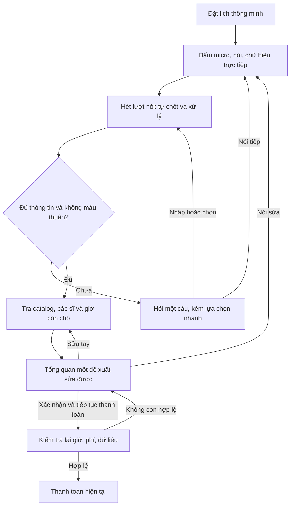

# PRD triển khai Smart Scheduling — hội thoại streaming

**Phiên bản:** 1.0 · **Ngày:** 2026-10-15 · **Trạng thái (19/10/2026):** Đã triển khai trong app và backend ([backend](backend/README.md), [app](flutter_app/SMART-SCHEDULING.md)). Đã chạy với OpenAI bằng key thật cho phần nhập tay, gồm cả ca cần cấp cứu ([kết quả kiểm thử](docs/kiem-thu-ai-that.md)). Chưa đo nhận giọng nói tiếng Việt, độ trễ hay chi phí, và chưa có log thử với người dùng.

Tài liệu này là đầu vào hiện hành cho việc implement Smart Scheduling. Thay thế các lựa chọn model và quy trình nhánh Smart trong [PRD ban đầu](prd-smart-scheduling.md), [nghiên cứu v1](smart-scheduling-research.md) và bổ sung tiêu chí thực thi cho [luồng hội thoại v2](smart-scheduling-conversation.md). Luồng đặt lịch cơ bản, footer chỉ icon và thanh toán giả lập hiện tại được giữ nguyên.

**Baseline:** App Flutter bước 1–4 tại commit `a6e0e9a` đã được đẩy lên nhánh `codex/booking-ui-smart-scheduling-prd`. Analyze sạch và 52 test pass trước bàn giao. Đã cài/mở trên OPPO A77s; chủ dự án báo hoàn thành thử luồng đặt lịch, chưa có log chi tiết để suy ra chỉ số UX. Lúc viết PRD, backend chỉ có mẫu `.env`, chưa có dịch vụ AI hoạt động; trạng thái hiện tại ở dòng đầu.

Các thông số thử nghiệm bên dưới là đề xuất để triển khai/đo kiểm, không phải kết quả benchmark hoặc quy tắc lâm sàng đã được phê duyệt.

## 1. Mục tiêu và phạm vi

Người dùng nói nhu cầu một cách tự nhiên, thấy chữ trực tiếp, trả lời phần còn thiếu và duyệt một bản đề xuất đầy đủ trước khi vào thanh toán. Không phải duyệt transcript riêng, bấm Gửi sau mỗi lượt hoặc thực hiện lại toàn bộ các màn của luồng cơ bản.

| Ưu tiên | Trong phạm vi bản thử nghiệm |
| --- | --- |
| P0 | STT streaming, tự xác định hết lượt, tự gửi nội dung final để xử lý |
| P0 | Hội thoại hỏi lại đến khi đủ dữ liệu; trả lời bằng nói, nhập tay hoặc lựa chọn nhanh |
| P0 | Lấy vị trí foreground theo yêu cầu người dùng; luôn có chọn/nói khu vực thay thế |
| P0 | Đề xuất khoa, cơ sở, bác sĩ, giờ và phí từ catalog/lịch khả dụng |
| P0 | Một bản tổng quan sửa được; xác nhận → kiểm tra lại → Thanh toán hiện tại |
| P0 | Backend local giữ key, model tiết kiệm, mock mode để test không có key |
| P0 | Phản hồi cũ, hủy, mạng lỗi, giới hạn phiên/chi phí, quyền riêng tư và fallback |
| P1 | Đo và hiệu chỉnh nhận hết lượt/nhận tiếng Việt trên OPPO |
| Ngoài phạm vi | Chẩn đoán, thuốc/điều trị; tự đặt lịch/thu tiền bằng giọng nói; lịch bệnh viện hoặc BHYT thật |
| Ngoài phạm vi | Dự đoán ít chờ khi chưa có dữ liệu vận hành; TTS đọc câu hỏi; lưu lịch sử sức khỏe dài hạn; deploy production |

Không bắt dùng AI để đặt khám. “Giờ còn chỗ sớm nhất” khác “ít chờ nhất”; bản này chỉ hỗ trợ tiêu chí thứ nhất khi phù hợp lựa chọn người dùng.

## 2. Model và cấu hình chi phí

| Thành phần | Mặc định giai đoạn test | Quy tắc |
| --- | --- | --- |
| Hỏi đáp, trích xuất/sửa dữ liệu và lập đề xuất | `gpt-6-luna`, Responses API, reasoning `low`, Structured Outputs | Chọn model tiết kiệm theo yêu cầu chủ dự án. Không tự nâng lên model đắt khi lỗi hoặc thiếu dữ liệu. |
| Chữ trực tiếp từ microphone | `gpt-live-transcribe`, Realtime transcription | Giữ yêu cầu streaming thật; không thay bằng tải file sau khi nói xong mà vẫn ghi nhãn realtime. |
| Catalog, lọc bác sĩ, tra giờ, phí và kiểm tra khả dụng | Logic/repository phía server | LLM không phải nguồn sự thật cho ID, lịch và phí. |

Theo tài liệu truy cập ngày 2026-10-15, Luna hỗ trợ Structured Outputs và reasoning `low`; giá niêm yết Standard là $0.10/triệu token đầu vào và $0.50/triệu token đầu ra. Đây là lựa chọn tiết kiệm để kiểm thử, không khẳng định chất lượng lâm sàng tương đương model lớn. [Nguồn Luna](https://developers.openai.com/api/docs/models/gpt-6-luna).

Model live hiện có giá $0.017/phút audio. Cần đo riêng chi phí STT và hỏi đáp; tiết kiệm text không loại bỏ chi phí audio. Chưa xác minh quyền model/quota tài khoản hoặc chất lượng tiếng Việt bằng key thực. [Nguồn STT](https://developers.openai.com/api/docs/models/gpt-live-transcribe).

Backend nạp biến từ [mẫu `.env.example`](backend/.env.example). Key không nằm trong APK, Flutter asset, `--dart-define`, Git, log hoặc phản hồi lỗi. Chỉ URL backend được đưa vào cấu hình app. Đổi model phải được chủ dự án chủ động cấu hình và chạy lại eval; không có fallback model đắt tự động.

## 3. Điểm vào và trải nghiệm chính

- Trang chủ: thêm lối vào phụ “Đặt lịch thông minh” trong nội dung trang, giữ nút Bắt đầu luồng cơ bản và footer hiện tại.
- Bước Chuyên khoa của luồng cơ bản: thêm “Chưa biết chọn khoa?” để mở cùng nhánh Smart, mang theo người khám/hình thức/cơ sở đã chọn.
- Luồng Smart nằm trên navigator gốc, tương tự booking; không sửa số tab hoặc thiết kế footer.
- Câu hỏi hiển thị bằng chữ, có lựa chọn nhanh, micro và nhập tay. Chưa đọc câu hỏi bằng giọng nói ở vòng này.

Không tạo màn duyệt transcript hoặc nút Gửi bắt buộc cho mỗi lượt nói. Xác nhận duy nhất ở cuối là xác nhận nội dung đề xuất, không phải chấp thuận tự động thu tiền.

## 4. Màn hình và trạng thái

| Mã | Trạng thái | Nội dung và thao tác |
| --- | --- | --- |
| SS00 | Sẵn sàng | Mô tả ngắn, dữ liệu bệnh viện minh họa, micro, nhập tay, quay về luồng cơ bản |
| SS01 | Kết nối | Trạng thái rõ; chưa báo đang nghe khi stream chưa sẵn sàng; có Hủy |
| SS02 | Đang nghe | Chữ tạm/final, thời gian, chỉ báo microphone, Dừng, “Xong lượt nói” tùy chọn |
| SS03 | Xử lý lượt | Hiển thị đang cập nhật; hỗ trợ nói tiếp trong phiên đang bật micro hoặc hủy; không hiện đề xuất cũ như kết quả mới |
| SS04 | Hỏi bổ sung | Một câu và lựa chọn nhanh; Nói tiếp, Nhập tay; micro tắt khi chờ câu trả lời mới |
| SS05 | Tổng quan đề xuất | Người khám, hình thức, cơ sở/địa chỉ, khoa/lý do, bác sĩ, ngày giờ, phí, liên hệ; Sửa từng phần/Nói lại/Hoàn tác |
| SS06 | Kiểm tra và bàn giao | Khóa gửi lặp, kiểm tra version/giờ/phí; chỉ chuyển sang Thanh toán nếu hợp lệ |
| SS07 | Lỗi hoặc thiếu khả năng hỗ trợ | Giải thích ngắn, thử lại có chủ đích, nhập tay hoặc luồng cơ bản; giữ dữ liệu hợp lệ |
| SS08 | Cần hỗ trợ y tế | Luồng nội dung chuyên môn riêng, không tiếp tục đặt khám thường tự động |

Giữ theme, font, icon, cỡ chữ lớn và giảm chuyển động bước 4. Đánh dấu rõ micro đang bật/tắt; transcript streaming không tạo một live-region thông báo cho mọi ký tự. Câu hỏi/kết quả final và lỗi có nhãn hỗ trợ đọc màn hình phù hợp.

## 5. Streaming, VAD và sửa bằng nói tiếp

1. Bấm micro là thao tác bắt đầu gửi audio; giải thích ngay tại đây âm thanh được truyền đến dịch vụ để xử lý. Xin quyền micro khi cần, không ghi âm trước hành động này.
2. Stream PCM mono 24 kHz qua WebSocket app → backend → OpenAI. Không ghi file sức khỏe vào thư viện chung; buffer có giới hạn và được dọn khi dừng/lỗi/đóng phiên.
3. `gpt-live-transcribe` yêu cầu bỏ `turn_detection` hoặc đặt `null`; không cấu hình `server_vad`/`semantic_vad` cho model này. VAD ở ứng dụng gửi commit khi hết lượt. [Nguồn realtime](https://developers.openai.com/api/docs/guides/realtime-transcription).
4. Khoảng lặng thử ban đầu 1.5–2 giây; đo với người nói chậm, ngừng lấy hơi và âm nền. Luôn có nút “Xong lượt nói” tùy chọn và Dừng. Không cam kết phát hiện hết lượt hoàn hảo.
5. Delta chỉ hiển thị; đợi final transcript của đúng item/lượt mới tự phân tích. Không tạo yêu cầu hỏi đáp trên từng delta.
6. “Sáng thứ Sáu… à không, chiều thứ Bảy” cập nhật ngày/buổi, không giữ cả hai như hai ý định đồng thời. Chỉ sửa trường có ý định rõ; nếu mâu thuẫn chưa giải quyết được thì hỏi lại.
7. Người dùng nói tiếp khi đang xử lý: nhận lượt mới khi phiên micro còn bật, tăng version và loại kết quả cũ. Không cho kết quả đến chậm mở thanh toán hoặc ghi đè sửa đổi mới.
8. Khi đã hiện câu hỏi hoặc proposal, tắt microphone và chờ người dùng bấm Nói tiếp. Rời trang, app vào nền, hết hạn phiên hoặc vào thanh toán phải dừng capture và đóng kết nối cần thiết.
9. Nếu ngắt mạng, không ghi âm nền để tải bù vô hạn và không tự replay audio/lượt đã gửi. Cho người dùng biết phần nào chưa hoàn tất và chủ động nói/nhập lại.

## 6. Thông tin cần thu thập và hỏi lại

| Trường | Nguồn có thể dùng | Khi còn thiếu |
| --- | --- | --- |
| Người khám | Ngữ cảnh booking, chọn hồ sơ, lời nói xác định rõ | Hỏi “Bạn đặt cho ai?”, cho chọn/thêm hồ sơ; không mặc định từ hồ sơ đang duyệt ở tab |
| Hình thức | Ngữ cảnh, lời nói, nút BHYT/dịch vụ | Hỏi một câu; không tự chuyển sang dịch vụ để có nhiều giờ |
| Khu vực/cơ sở | Cơ sở đã chọn, nói/nhập khu vực, vị trí được cấp quyền | Hỏi nơi muốn khám; không hỏi vị trí nếu đã chọn cơ sở đủ rõ |
| Triệu chứng/yêu cầu | Lời nói final hoặc nhập tay | Hỏi bổ sung phù hợp nội dung chuyên môn; không tự thêm triệu chứng |
| Khoa | Gợi ý có giải thích + người dùng duyệt cuối, hoặc chọn tay | Có trạng thái không đủ thông tin/ngoài catalog, không ép chọn khoa bất kỳ |
| Bác sĩ | Lựa chọn đích danh hoặc đề xuất trong khoa/cơ sở | Không bắt biết tên bác sĩ; nếu có ràng buộc đích danh phải giữ hoặc hỏi trước khi đổi |
| Ngày/buổi/giờ | Ngày nói rõ, picker hoặc “Sớm nhất còn chỗ” | Hỏi ưu tiên thời gian; có lựa chọn nhanh thay vì yêu cầu đọc hết lịch |
| Liên hệ nhận thông báo | Thông tin sẵn có hoặc sửa tay | Hiển thị để duyệt; phải hợp lệ trước bàn giao, không tự nhận dữ liệu giả là liên hệ thật |

Hỏi mỗi lượt một điểm cần làm rõ và không hỏi lại trường hợp lệ đã có. Không giữ giới hạn cứng hai câu của prototype ban đầu. Có thể tiếp tục hỏi đến khi đủ nhưng phải cho thoát/nhập tay để tránh hội thoại vòng lặp; sau hai lần không giải quyết được cùng một trường, ưu tiên picker hoặc hỗ trợ.

Vị trí: lựa chọn “Dùng vị trí hiện tại / Chọn khu vực hoặc cơ sở / Nói tiếp”. Chỉ xin quyền foreground sau khi bấm Dùng vị trí; từ chối quyền vẫn hoàn thành luồng được. Vị trí hiện tại không mặc định là nơi muốn khám. Chỉ gửi tọa độ vào logic tìm cơ sở nếu cần, không đưa tọa độ chính xác vào LLM hoặc log. Catalog minh họa chưa có tọa độ được kiểm chứng: không tạo nhãn “gần nhất” giả; phải có fixture gắn nhãn hoặc fallback chọn khu vực.

## 7. Đề xuất và chỉnh sửa

- Proposal chỉ tham chiếu ID cơ sở/khoa/bác sĩ/slot hợp lệ từ repository. Tên, phí, địa chỉ hiển thị lấy từ catalog, không lấy nguyên văn do model bịa.
- Chỉ cần một đề xuất chính với lý do ngắn; không xếp hạng “bác sĩ giỏi nhất” hoặc hiển thị phần trăm chính xác không được hiệu chuẩn.
- Sửa bằng nhập/dropdown/picker hoặc nói lại. Trường được sửa tay có nguồn/provenance và version; không bị model cũ ghi đè. Có thể Hoàn tác sửa mới nhất trong phiên.
- Đổi người khám xóa triệu chứng/transcript/gợi ý người cũ; dữ liệu chung không nhạy cảm chỉ giữ nếu còn phù hợp.
- Đổi hình thức/cơ sở/khoa/bác sĩ/ngày tuân thủ quy tắc xóa lựa chọn phụ thuộc của booking hiện tại. Nếu đề xuất lại, nêu rõ phần nào vừa thay đổi; không reset toàn bộ hội thoại.
- Chỉ cho “Xác nhận và tiếp tục thanh toán” khi đủ thông tin, không đang nghe/xử lý sửa đổi, không có câu hỏi chưa giải quyết hoặc cảnh báo yêu cầu hỗ trợ y tế.

## 8. Nối với BookingController và thanh toán

Hành động áp dụng proposal phải nguyên tử: đọc proposal version, kiểm tra ID/eligibility, tuổi, hình thức, giờ, phí và liên hệ, rồi cập nhật BookingDraft và bước Payment. Chưa có bất kỳ thay đổi một phần nào nếu validation thất bại.

Không bắt người dùng đi lại sáu màn lựa chọn hoặc duyệt thêm một màn Kiểm tra giống hệt. Giữ BookingRepository/ledger và các trạng thái failed/checking/paidUnconfirmed/confirmed của bản hiện tại. Cần giữ vòng đời provider khi chuyển route để draft không bị autoDispose làm mất dữ liệu bàn giao.

Nếu slot mất: giữ phần còn hợp lệ, đề xuất giờ khác, quay về tổng quan và yêu cầu xác nhận lại. Nếu phí thay đổi: thể hiện mức mới và duyệt lại. Model không có quyền gọi submit thanh toán. Chỉ có người dùng bấm nút thanh toán hiện có mới tạo giao dịch mô phỏng; giữ kiểm tra lại availability ở thời điểm submit và cơ chế chống gửi lặp.

## 9. Backend, dữ liệu và hợp đồng

Backend local đề xuất Node.js, OpenAI SDK chính thức và WebSocket. Runtime/dependencies cài riêng trong dự án, lockfile được commit, không đổi môi trường User/Machine; SDK/cache/node_modules không lên Git. Không phụ thuộc cloud để thử trên OPPO.

| Giao diện nội bộ dự kiến | Chức năng |
| --- | --- |
| `GET /health` | Trả trạng thái cấu hình/model/mode, không trả key, không tự phát sinh lượt gọi OpenAI |
| `POST /v1/smart/sessions` | Tạo phiên, ngữ cảnh đã kiểm tra, hạn phiên và quyền truy cập cục bộ |
| WebSocket của phiên | Audio append/commit/cancel, transcript delta/final, câu hỏi/proposal và lỗi |
| `POST /v1/smart/sessions/:id/turns` | Lượt nhập tay hoặc lựa chọn nhanh; dùng chung bộ điều phối với voice |
| `POST /v1/smart/sessions/:id/confirm` | Chốt đúng proposal version, revalidate và trả dữ liệu bàn giao Payment |
| `DELETE /v1/smart/sessions/:id` | Đóng phiên, hủy tác vụ đang chạy và xóa buffer/dữ liệu tạm |

Tên endpoint là hợp đồng đề xuất, cần chốt trong code/test cùng lúc. Không biến backend thành proxy OpenAI tổng quát: model, system prompt, tool allowlist, giới hạn token/audio và catalog do server kiểm soát. Không nhận API key từ app hoặc trả stack trace/raw provider response xuống UI.

Mỗi sự kiện có `session_id`, `turn_id`, `request_id`, `draft_version`; proposal có `proposal_id`, `proposal_version`, `catalog_version`, `availability_checked_at`, ID lựa chọn và chi phí. Reconnect không nối nhầm phiên; item_id OpenAI được mapping sang turn nội bộ. Refusal, response incomplete và JSON lỗi không được hiển thị như proposal hợp lệ. Structured Outputs chỉ bảo đảm dạng dữ liệu, không bảo đảm đúng về y khoa.

Catalog/lịch hiện vẫn là mock. Server và app phải dùng cùng catalog/version hoặc có contract test phát hiện drift; client gửi ID không đủ để chứng minh ID/slot đó hợp lệ. Không copy dữ liệu fake sang production mà bỏ nhãn minh họa. Clinical rules và danh mục cơ sở thực là đầu vào riêng chưa được cung cấp.

## 10. Giới hạn phiên, lỗi và quyền riêng tư

Thông số thử ban đầu, cấu hình tại server và cần có test thực thi:

- 60 giây/lượt audio; 5 phút/phiên micro tổng; tự dừng và báo trước khi hết hạn. Không chỉ giới hạn UI.
- Giới hạn byte tương ứng audio PCM, số kết nối và hàng đợi; phát hiện chậm phía mạng bằng backpressure, không giữ buffer tăng vô hạn.
- Tối đa một tác vụ hỏi đáp hiện hành/phiên; có version để bỏ phản hồi cũ. Giới hạn 12 lượt gọi model/phút/phiên, không tự phân tích lại khi repaint hoặc nhận delta.
- Timeout kết nối/thao tác; không retry tự động lỗi key/quyền. Lỗi tạm chỉ retry tối đa một lần có backoff nếu lượt vẫn còn hiện hành và chưa có kết quả; không replay audio đã commit.
- Giới hạn output, ví dụ `max_output_tokens=1200` ban đầu; đo response incomplete trước khi chỉnh. Không tự tăng cap hoặc đổi model đắt để vượt giới hạn.
- Ghi log kỹ thuật/request ID/usage/độ trễ, không log key, transcript, triệu chứng, hồ sơ hoặc tọa độ. Không tạo log thử có thông tin nhận dạng trong Git.
- Phiên mặc định chỉ ở bộ nhớ. Dọn khi đóng, hết hạn hoặc restart; không âm thầm lưu transcript/audio trong lịch hẹn hoặc local storage. Nếu cho lưu sau này phải có yêu cầu riêng.

Backend chỉ bind localhost trong chế độ USB dev; không public tunnel hoặc mở LAN mặc định. `adb reverse tcp:8080 tcp:8080` nối OPPO tới máy; Flutter chỉ cấu hình `API_BASE_URL`. HTTP localhost chỉ mở giới hạn ở debug, release dùng HTTPS. Trước deploy thật cần xác thực, quota theo người dùng và controls cho dữ liệu sức khỏe; không coi server localhost là kiến trúc production đã hoàn tất.

Với Responses dự kiến `store: false`, nhưng không cam kết không lưu ở mọi lớp nhà cung cấp; đối chiếu [data controls](https://developers.openai.com/api/docs/guides/your-data). Khi chưa có key, mock mode phải hiển thị rõ “Mô phỏng AI”; không giả vờ đã nhận giọng hoặc đã gọi OpenAI thật.

## 11. Nhánh hỗ trợ y tế và điều kiện đưa vào dùng thật

Nhận diện/yêu cầu hỗ trợ khẩn phải có quy tắc và nội dung do chuyên môn duyệt, không dựa duy nhất vào model rẻ hoặc một bộ từ khóa đơn giản. Không kết luận “an toàn” chỉ vì model không cảnh báo. Nhánh nghi ngờ khẩn không fallback tự động sang chọn lịch thường. Nội dung liên hệ/địa bàn phải được xác minh, không tự tạo số điện thoại hỗ trợ.

Bản implement đầu tiên là prototype dùng dữ liệu/tình huống giả định và gắn nhãn rõ. Chưa được coi là công cụ phân luồng y khoa sử dụng thật trước khi có nội dung chuyên môn, bộ đánh giá và các điều kiện vận hành tương ứng.

## 12. Tiêu chí nghiệm thu

| Mã | Tình huống | Kết quả cần đạt |
| --- | --- | --- |
| AC01 | Nói một yêu cầu đầy đủ | Chữ hiện khi đang nói; sau hết lượt tự xử lý, không có màn/nút xác nhận transcript bắt buộc |
| AC02 | Chỉ nói triệu chứng, chưa rõ nơi khám | Hỏi khu vực với ba cách trả lời; không dựng cơ sở/bác sĩ/giờ từ suy đoán |
| AC03 | Đã vào từ booking có cơ sở/người/hình thức | Giữ ngữ cảnh, không hỏi lại các trường đã rõ |
| AC04 | Không cấp quyền micro/vị trí | Nhập tay/chọn khu vực vẫn hoàn thành được |
| AC05 | Nói sửa ngày trong cùng hoặc lượt sau | Thay đổi đúng ngày/buổi, giữ triệu chứng và các trường còn hợp lệ |
| AC06 | Nói tiếp khi đang chờ, sự kiện final đảo thứ tự | Chỉ draft version mới nhất có hiệu lực; không ghi đè hoặc bàn giao proposal cũ |
| AC07 | Sửa tay rồi phản hồi model cũ tới | Giá trị sửa tay được giữ, có dấu hiệu trường đã sửa và Hoàn tác |
| AC08 | Model trả ID lạ, ngoài phạm vi tuổi/BHYT hoặc response không hoàn chỉnh | Server từ chối; hỏi lại/fallback, không tạo proposal thanh toán được |
| AC09 | Proposal đủ, người dùng xác nhận | Kiểm tra giờ/phí, áp dụng draft nguyên tử và mở Payment; không lặp toàn bộ luồng |
| AC10 | Slot vừa hết/giá đổi khi xác nhận | Quay lại tổng quan cập nhật; giữ dữ liệu hợp lệ và cần duyệt lại |
| AC11 | Submit/checking/paidUnconfirmed | Giữ hành vi chống trùng/không thúc trả lại tiền của booking hiện tại |
| AC12 | Mất mạng/hủy/background/hết hạn | Micro và kết nối được dừng/dọn; không gửi ngầm hoặc replay vô hạn |
| AC13 | Mock mode/no key/401/403/429 | Phân biệt cấu hình/mạng/quota, không lộ key hoặc tự nâng model đắt |
| AC14 | Tình huống cần hỗ trợ y tế trong bộ thử được duyệt | Hiện nhánh hỗ trợ, không tiếp tục đặt khám thường tự động |
| AC15 | Chữ 200–250%, giảm chuyển động, bàn phím, đọc màn hình | Trường/nút không bị cắt, micro có trạng thái rõ; không thông báo mọi ký tự delta |
| AC16 | Quay lại luồng cơ bản | Chuyển các lựa chọn hợp lệ, xóa phần phụ thuộc không hợp lệ, không bắt dùng AI |
| AC17 | Đổi người khám | Xóa triệu chứng/transcript/gợi ý của người trước; không lẫn nội dung sức khỏe |

Kiểm tra bắt buộc: unit cho merge/version/validation; backend integration với provider fake; widget/route cho hỏi-sửa-proposal-Payment; replay stream trễ/đảo thứ tự; nguyên vẹn 52 test baseline; analyze/build APK; smoke test OPPO. Khi có key, test STT thật với audio có đồng ý sử dụng, ghi WER/lỗi đổi nghĩa, độ trễ và chi phí. Chất lượng chọn khoa cần nhãn chuyên môn, không tự tạo số liệu đạt chuẩn.

## 13. Các đợt triển khai

1. **Nền backend và contract:** runtime local, `.env`, health, catalog mock đồng bộ, mock/real adapter, schema/version/giới hạn và test không cần key.
2. **Hội thoại nhập tay:** điểm vào, hỏi bổ sung, lựa chọn nhanh, draft, proposal/sửa/Hoàn tác và bàn giao thanh toán. Footer/booking cơ bản giữ nguyên.
3. **Voice streaming:** recorder/VAD, WebSocket relay, delta/final, nói sửa/nói tiếp, xin quyền và hủy/dọn buffer.
4. **Vị trí và hoàn thiện:** quyền foreground, fixture vị trí có nhãn, hỗ trợ chữ lớn/giảm chuyển động, fallback và giới hạn chi phí.
5. **Kiểm chứng có key:** OPPO, tiếng Việt đa giọng/ngừng lấy hơi/tiếng ồn, quota/latency/cost và sửa vấn đề theo log ẩn danh. Chưa deploy hoặc nâng model khi chưa có yêu cầu.

**Điều kiện hoàn thành:** Code và tài liệu chạy/gỡ môi trường được bàn giao; test tự động pass; có ghi rõ phần mock và phần đã/ chưa thử bằng key thật. Không ghi “STT/AI đã hoạt động thực tế” nếu chỉ qua provider giả.
