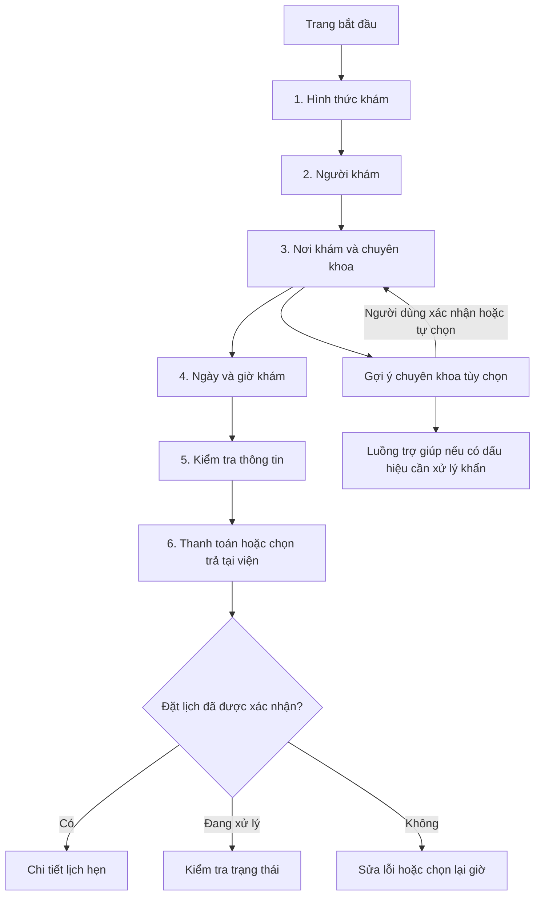

# PRD — Đặt lịch khám thông minh (Smart Scheduling)

**PRD triển khai mới:** [Smart Scheduling — hội thoại streaming](prd-smart-scheduling-implementation.md), ngày 2026-10-15, bổ sung luồng đã thống nhất, model tiết kiệm và tiêu chí nghiệm thu để implement. Tài liệu dưới đây giữ bối cảnh/luồng cơ bản của vòng prototype ban đầu.

**Phiên bản:** 0.1 · **Ngày:** 2026-10-14 · **Trạng thái:** Đã duyệt bố cục prototype; luồng cơ bản và Smart Scheduling đã triển khai trong app (xem [PRD triển khai](prd-smart-scheduling-implementation.md)). Nội dung dưới đây giữ nguyên bản 0.1 để truy xuất quyết định.

**Đầu ra của giai đoạn này:** Prototype tương tác để duyệt trải nghiệm trước khi áp dụng vào Flutter. Không sửa code app, không tích hợp AI, dữ liệu bệnh viện hoặc thanh toán thật ở giai đoạn này.

**Cập nhật sau luồng cơ bản:** Chủ dự án đã yêu cầu nhánh Smart Scheduling dạng [hội thoại streaming v2](smart-scheduling-conversation.md). Với nhánh này, yêu cầu mới thay thế phần 7.1 bên dưới: không duyệt transcript riêng, tự xử lý hết lượt nói, hỏi lại đến khi đủ dữ liệu, duyệt một bản tổng quan khoa/bác sĩ/giờ rồi chuyển sang Thanh toán. Luồng cơ bản giữ nguyên. Các mô tả prototype cũ còn lại là tài liệu của vòng ban đầu.

Những yêu cầu chưa được bệnh viện xác nhận là giả định thiết kế, được đánh dấu bên dưới.

## 1. Vấn đề, bằng chứng và mục tiêu

Theo tóm tắt phỏng vấn do chủ dự án cung cấp, người trên 50–60 tuổi có thể gặp khó khăn khi tự đặt khám trên app vì phải thực hiện nhiều bước và lựa chọn chuyên khoa. Họ thường nhờ con cái hoặc đến bệnh viện nhờ nhân viên thao tác hộ. Chưa có log ẩn danh, số mẫu, số bước đo thực tế hoặc tỷ lệ thất bại; không gán mã P1/P2 hoặc tạo trích dẫn giả.

**Khoảnh khắc ưu tiên:** Từ lúc muốn đặt một lượt khám ngoại trú đến khi biết rõ mình đã có lịch nào, cho ai, tại đâu và cần làm gì tiếp theo.

**Nhu cầu làm việc tạm thời:** Người lớn tuổi cần một cách đặt khám dễ hiểu, có thể kiểm tra và sửa lựa chọn, để giảm phụ thuộc vào người khác. Cần đối chiếu phát biểu này với log nghiên cứu trước khi chốt need statement chính thức.

Mục tiêu:

1. Hoàn thành luồng đặt khám cơ bản mà không cần AI hoặc trợ giúp trực tiếp.
2. Hiểu người khám, hình thức, cơ sở, khoa/bác sĩ, ngày giờ và chi phí trước khi xác nhận.
3. Khi Smart Scheduling không hỗ trợ được, tiếp tục bằng luồng cơ bản mà không nhập lại dữ liệu còn hợp lệ.
4. Tạo nền để nghiên cứu gợi ý khoa và giờ dự kiến ít chờ sau khi luồng cơ bản được duyệt.

Không tối ưu bằng cách chỉ giảm số màn hình. Ưu tiên ít lựa chọn gây bối rối, nội dung dễ đọc và khả năng hoàn thành tác vụ.

## 2. Người dùng và bối cảnh

| Nhóm | Nhu cầu | Hỗ trợ thiết kế |
| --- | --- | --- |
| Người tự đặt khám, trọng tâm 50–60+ | Dễ đọc, dễ chọn, biết đã làm đến đâu | Chữ lớn, từ ngữ quen thuộc, vùng bấm rộng, kiểm tra cuối luồng |
| Con cái/người chăm sóc đặt hộ | Chọn đúng người và không nhầm thông tin liên hệ | Nhãn người khám xuyên suốt, tách người khám với người nhận thông báo |
| Người chưa biết chọn khoa | Có định hướng hoặc liên hệ hỗ trợ | Gợi ý tùy chọn; luôn có tự chọn và trợ giúp |

Không dùng tuổi để suy ra năng lực số. Thử nghiệm cần ghi mức quen dùng điện thoại và nhu cầu hỗ trợ thực tế.

**Giả định cho prototype:** Một tài khoản mẫu đã đăng nhập, có một hồ sơ bản thân và một hồ sơ người thân. Cho thêm người khám dạng dữ liệu minh họa. Đăng ký/OTP và xác thực quan hệ không phải luồng chính của vòng duyệt này; cần thiết kế riêng trước khi triển khai thật.

## 3. Phạm vi và ưu tiên

| Mức | Hạng mục | Yêu cầu ở vòng prototype |
| --- | --- | --- |
| P0 | Đặt khám cơ bản | Toàn bộ luồng từ chọn hình thức đến xác nhận |
| P0 | Quay lại, sửa, giữ lựa chọn hợp lệ | Hoạt động xuyên suốt, gồm đổi người/khoa/ngày |
| P0 | Hết giờ, lỗi mạng, lỗi/chờ thanh toán | Có màn hình và hành động phục hồi |
| P0 | Khả năng tiếp cận, hỗ trợ đặt hộ | Áp dụng cho tất cả màn hình |
| P1 | Gợi ý khoa từ nhập/nói triệu chứng | Nhánh minh họa ngắn, có sửa nội dung và fallback |
| P1 | Gợi ý giờ dự kiến ít chờ | Minh họa có dữ liệu và trường hợp thiếu dữ liệu |
| P1 | Lịch hẹn đã tạo | Xem lại chi tiết và hướng dẫn đến khám |
| Ngoài phạm vi | Chẩn đoán, kê đơn, tư vấn điều trị | Không thiết kế thành tính năng của prototype |
| Ngoài phạm vi | API bệnh viện, BHYT, dự báo thật, ghi âm thật, cổng thanh toán | Chưa tích hợp; chỉ mô phỏng trạng thái cần duyệt |
| Ngoài phạm vi | Đổi/hủy lịch, hoàn tiền đầy đủ, quản lý điều trị | Ghi nhận để thiết kế ở giai đoạn sau |

Không yêu cầu AI để bắt đầu, đi tiếp hoặc kết thúc luồng cơ bản.

## 4. Các nguyên tắc tham chiếu

Theo [nghiên cứu best practice](../04-best-practice/README.md):

- **MyTherapy:** Hướng thị giác tối giản là lựa chọn của chủ dự án; lấy cảm hứng từ việc tập trung vào tác vụ, không sao chép thương hiệu. Chưa có bộ screenshot app được duyệt để làm chuẩn pixel.
- **MyVinmec và Bạch Mai Care:** Tham khảo tác vụ đặt khám và hồ sơ/người thân. Thứ tự trong PRD là yêu cầu sản phẩm, chưa được xác minh là thứ tự từng màn hình của các app hiện hành.
- **Ada:** Tham khảo cách nêu giới hạn của hỗ trợ triệu chứng. Không suy ra hiệu quả chọn khoa hoặc khả năng đặt lịch từ Ada.

## 5. Kiến trúc trải nghiệm và luồng cơ bản

Trang bắt đầu chỉ ưu tiên hai việc: **Đặt lịch khám** và **Xem lịch hẹn**. Khi chưa có lịch, hiển thị trạng thái trống có nút đặt lịch. Không thêm bảng tin, quảng cáo, điểm thưởng hoặc chatbot tự bật.

Các tiểu màn hình chọn cơ sở, khoa và bác sĩ đều thuộc **bước 3/6**. Không bắt người dùng lướt một trang dài chứa mọi danh sách. Sau khi vào luồng, ẩn điều hướng đáy của trang bắt đầu để tránh rời luồng vô ý; vẫn có nút quay lại và trợ giúp.

| ID | Màn hình | Nội dung và hành động chính | Điều kiện đi tiếp |
| --- | --- | --- | --- |
| S00 | Bắt đầu | “Đặt lịch khám” nổi bật; lịch sắp tới nếu có; “Xem lịch hẹn” thứ cấp | Không bắt xem hướng dẫn hoặc dùng AI |
| S01 | Hình thức khám | Hai thẻ “Khám BHYT” và “Khám dịch vụ (tự chi trả)”; mô tả ngắn, dễ hiểu | Chủ động chọn một hình thức, không mặc định lựa chọn có thể phát sinh phí |
| S02 | Người khám | “Bản thân”, hồ sơ người thân; tên và năm sinh đủ phân biệt; “Thêm người khám” | Chọn hồ sơ hợp lệ; nhãn tên người khám xuất hiện ở các bước sau |
| S02a | Thêm người khám | Form ngắn theo từng nhóm; tên, ngày sinh, liên hệ và trường bắt buộc do bệnh viện xác nhận; không tự yêu cầu ảnh CCCD | Trường minh họa được kiểm tra ngay tại chỗ; quay lại không làm mất form |
| S03a | Nơi khám | Danh sách cơ sở, địa chỉ ngắn, hình thức được hỗ trợ; không ép cấp quyền vị trí | Có cơ sở hỗ trợ lựa chọn hiện tại hoặc có đường đổi hình thức/cơ sở |
| S03b | Chuyên khoa | Danh sách + tìm kiếm; tên khoa kèm mô tả phạm vi bằng ngôn ngữ dễ hiểu, nội dung phải được chuyên môn duyệt; “Chưa biết chọn khoa?” | Người dùng xác nhận một khoa; nhánh AI không tự động đi tiếp |
| S03c | Bác sĩ | Mặc định “Bác sĩ phù hợp còn lịch”; tùy chọn chọn đích danh; lọc theo cơ sở, khoa và hình thức | Không yêu cầu biết tên bác sĩ; chọn đích danh chỉ hiển thị lịch người đó |
| S04 | Ngày và giờ | Ngày dạng dễ đọc, lịch tháng là tùy chọn; nhóm Sáng/Chiều; giờ còn chỗ, hết chỗ và chưa chọn phân biệt rõ | Một giờ đang khả dụng; nếu không chọn đích danh thì hiện bác sĩ ứng với giờ |
| S05 | Kiểm tra | Người khám, hình thức, cơ sở/địa chỉ, khoa, bác sĩ hoặc trạng thái chưa phân công, ngày giờ, liên hệ, phí và mục “Sửa” | Dữ liệu hợp lệ; kiểm tra lại khả dụng và phí trước khi thanh toán |
| S06 | Thanh toán | Phương thức hợp lệ, số tiền, chi tiết phạm vi khoản thu; “Thanh toán tại viện” nếu chính sách cho phép | Hành động chủ động của người dùng; không báo xác nhận lịch chỉ vì nhấn nút |
| S07 | Kết quả và lịch hẹn | Trạng thái rõ, mã lịch mẫu, nội dung tóm tắt, trạng thái thanh toán, giấy tờ cần mang theo, hướng dẫn đến khám | Chỉ dùng “Đặt lịch thành công” khi đã có mã lịch được xác nhận |
| S08 | Danh sách/chi tiết lịch | Xem lại thông tin S07, nhận biết lịch đang xử lý/chưa xác nhận | Không trộn lịch chưa xác nhận với lịch thành công |

### Quy tắc chung của luồng

- Luôn có “Bước X/6”, tên bước và nút quay lại có chữ. Một CTA chính ở cuối màn hình, nhãn cụ thể như “Chọn người khám”, “Chọn ngày giờ”, “Kiểm tra thông tin”.
- Hiển thị tóm tắt người khám và các lựa chọn liên quan; không lặp một bảng dài trên mọi màn hình.
- Không chọn hộ BHYT/tự chi trả hoặc xác nhận thanh toán. Hồ sơ bản thân có thể được gợi ý nổi bật nhưng phải thể hiện lựa chọn rõ.
- Bản nháp chỉ giữ trong phiên prototype. Luồng thật có thể cần lưu bản nháp an toàn, nhưng không tự lưu triệu chứng nhạy cảm trên máy dùng chung.
- Khi trở lại từ mục “Sửa”, trả người dùng về S05 sau khi sửa xong, trừ khi lựa chọn mới làm bước sau không còn hợp lệ.

## 6. BHYT, phụ thuộc lựa chọn và thanh toán

### BHYT / tự chi trả

Không khẳng định cơ sở Vinmec/Bạch Mai cụ thể nhận BHYT, mức hưởng, yêu cầu chuyển tuyến hoặc số tiền người bệnh phải trả nếu chưa được đơn vị vận hành xác nhận. Prototype dùng cơ sở giả định có nhãn minh họa và các kịch bản hỗ trợ/không hỗ trợ BHYT.

Chọn “Khám BHYT” là yêu cầu hình thức, không phải xác nhận đã được duyệt quyền lợi. Hiển thị “Quyền lợi và khoản cần thanh toán sẽ được cơ sở xác nhận”. Không biến câu này thành lời hứa miễn phí hoặc tự áp dụng phần trăm hưởng. Nơi nào không hỗ trợ phải giải thích tại chỗ, cho đổi cơ sở hoặc chủ động đổi hình thức; tuyệt đối không tự chuyển sang dịch vụ.

### Dữ liệu cần chọn lại khi chỉnh sửa

| Thay đổi | Giữ lại | Kiểm tra/xóa lựa chọn phụ thuộc |
| --- | --- | --- |
| Hình thức | Người khám, liên hệ | Cơ sở/khoa/bác sĩ/giờ/phí cần kiểm tra lại; thông báo các mục phải chọn lại |
| Người khám | Hình thức, cơ sở nếu vẫn phù hợp | Xóa triệu chứng/gợi ý của người trước; kiểm tra phạm vi tuổi của khoa/bác sĩ và hủy giờ đang giữ nếu không còn phù hợp |
| Cơ sở | Người khám, hình thức | Xóa khoa/bác sĩ/giờ không thuộc cơ sở mới; cập nhật địa chỉ và phí |
| Khoa | Người khám, hình thức, cơ sở | Xóa bác sĩ/giờ cũ; kiểm tra lại giá và lịch |
| Bác sĩ hoặc ngày | Thông tin không phụ thuộc | Chọn lại giờ nếu không còn phù hợp |

Thông báo ví dụ: “Bạn vừa đổi nơi khám. Vui lòng chọn lại chuyên khoa và giờ khám.” Không chỉ hiển thị lỗi ở bước thanh toán.

### Trạng thái đặt lịch và thanh toán

| Tình huống | Cách hiển thị / phục hồi |
| --- | --- |
| Hết chỗ khi kiểm tra lại | Báo giờ vừa hết; giữ người/cơ sở/khoa, đưa về S04 với giờ khác; không tự đặt giờ thay thế |
| Đang giữ chỗ | Chỉ thể hiện hạn giữ khi backend thật có cơ chế đó; hết hạn thì chọn lại giờ. Prototype phải mô phỏng nhất quán |
| Thanh toán đang xử lý hoặc mất kết nối sau khi trả tiền | “Đang kiểm tra thanh toán”; kiểm tra lại trạng thái, không thúc người dùng trả lần nữa |
| Thanh toán thất bại rõ ràng | Cho thử lại/đổi phương thức nếu giờ còn hợp lệ; không tạo lịch trùng |
| Đã trả tiền nhưng chưa tạo được lịch | Hiển thị trạng thái chờ xử lý, mã giao dịch mẫu và hỗ trợ; không báo đặt lịch thành công hoặc tự hứa đã hoàn tiền |
| Trả tại viện | Nếu chính sách cho phép, lịch vẫn cần backend xác nhận; ghi “Chưa thanh toán — trả tại viện” |
| Lịch đã xác nhận | Hiển thị mã lịch, nơi/giờ đến và khoản đã/chưa trả; phân biệt giờ hẹn với thời điểm thực tế được bác sĩ khám |

Trong prototype, mọi khoản phí, mã QR, mã giao dịch và trạng thái đều là dữ liệu giả. Không điều hướng đến cổng thanh toán thật hoặc tạo mã có thể thanh toán. Khi triển khai, tạo lịch/thanh toán cần cơ chế chống gửi lặp và đối soát trước khi cho thử lại.

## 7. Smart Scheduling và fallback

### 7.1. Gợi ý chuyên khoa từ nhập hoặc nói triệu chứng

Điểm vào đặt ở S03b: **“Chưa biết chọn khoa? Nhập hoặc nói triệu chứng”**. Giữ ngữ cảnh cơ sở, hình thức và người khám đã chọn. Đây là lựa chọn phụ; danh sách khoa cơ bản vẫn nhìn thấy được.

Luồng minh họa:

1. Người dùng nhập văn bản hoặc chọn “Nói triệu chứng”. Nêu mục đích xử lý dữ liệu; không tự bật micro hoặc ghi âm nền.
2. Nếu dùng giọng nói, có trạng thái bắt đầu/dừng/hủy và bản chép lại để sửa. Bị từ chối quyền, nghe không rõ hoặc hết thời gian thì chuyển sang nhập tay/tự chọn khoa.
3. Người dùng xác nhận nội dung trước khi gửi. Nếu cần, hỏi bổ sung từng câu; prototype giới hạn tối đa hai câu để duyệt khả năng hiểu. Đây là giới hạn thiết kế thử, không phải quy tắc lâm sàng cho hệ thống thật.
4. Hiển thị một khoa gợi ý chính, có thể thêm một phương án thay thế nếu được quy tắc chuyên môn cho phép; có giải thích ngắn, “Chọn khoa này” và “Tự chọn khoa khác”. Không hiện tỷ lệ tin cậy giả.
5. Sau khi người dùng chọn, quay lại luồng cơ bản để chọn bác sĩ/ngày giờ. Bộ lọc bác sĩ dựa trên khoa, nơi khám, hình thức, phạm vi tiếp nhận và lịch còn chỗ; không gọi đây là bác sĩ giỏi nhất.

Không viết “AI gợi ý chính xác chuyên khoa”. Dùng **“Chuyên khoa gợi ý — cần được cơ sở y tế xác nhận”**. Cụm “đau đầu âm ỉ kèm buồn nôn” là đầu vào thử giao diện do chủ dự án nêu, không phải quy tắc tự động ánh xạ sang Thần kinh. Chưa có nội dung chuyên môn được duyệt thì kết quả mô phỏng phải ghi rõ minh họa, không cho người thử hiểu là tư vấn thật.

### 7.2. Gợi ý khung giờ dự kiến ít chờ

Điểm vào ở S04 sau khi đủ cơ sở/khoa, bác sĩ nếu chọn đích danh và phạm vi ngày. Luôn còn lựa chọn “Tất cả giờ còn chỗ”.

- Chỉ gợi ý trong các giờ có thể đặt, phù hợp lựa chọn của người dùng; không hy sinh ngày/bác sĩ đã chọn mà không xin xác nhận.
- Nếu có dữ liệu phù hợp: nhãn “Dự kiến ít chờ”, lý do ngắn và mốc cập nhật; giải thích đây là ước tính, có thể thay đổi khi bệnh viện tiếp nhận ca phát sinh.
- Cần lịch làm việc/khả dụng của bác sĩ, lịch đã đặt, tải tại viện, thời lượng lượt khám, độ mới và độ đầy đủ của dữ liệu. Dữ liệu lịch trống đơn thuần không đủ để khẳng định bệnh viện ít đông.
- Chưa có dữ liệu vận hành: bỏ nhãn ít chờ, chỉ hiển thị “Còn chỗ” và “Chưa có dữ liệu ước tính thời gian chờ”. Nếu sắp xếp theo giờ sớm nhất thì ghi đúng “Giờ còn chỗ sớm nhất”.
- Prototype cần hai trạng thái: dữ liệu ước tính minh họa có nhãn và không đủ dữ liệu. Không khẳng định “vắng nhất”, “không phải chờ” hoặc bịa số phút tiết kiệm.

### 7.3. Ma trận fallback bắt buộc

| Tình huống | Hành động | Dữ liệu giữ lại |
| --- | --- | --- |
| Không muốn dùng AI | Tự chọn khoa/giờ theo luồng cơ bản | Tất cả lựa chọn hợp lệ |
| Micro bị từ chối/giọng nói không rõ | Nhập tay hoặc tự chọn khoa | Bản chép tạm người dùng đã xác nhận và các lựa chọn trước |
| AI lỗi, chờ quá lâu, không đủ chắc chắn | Thông báo ngắn; “Tự chọn chuyên khoa”, “Nhờ hỗ trợ” | Không xóa hồ sơ đặt khám; không dùng kết quả chưa hoàn chỉnh |
| Khoa gợi ý không có tại cơ sở | Cho đổi cơ sở hoặc liên hệ hỗ trợ | Người khám/hình thức; chỉ reset các mục phụ thuộc |
| Không có bác sĩ/giờ phù hợp | Chọn ngày khác, bỏ chọn bác sĩ đích danh hoặc đổi cơ sở chủ động | Các lựa chọn không phụ thuộc |
| Không có dữ liệu tải bệnh viện | Danh sách giờ còn chỗ thông thường | Ngày/bác sĩ/khoa |
| Có dấu hiệu cần xử lý khẩn theo quy tắc được duyệt | Dừng gợi ý đặt lịch thường, hiện luồng trợ giúp phù hợp | Chỉ giữ dữ liệu cần thiết cho hỗ trợ, không tự tạo lịch |

Không coi tình huống có thể khẩn cấp là lỗi kỹ thuật để fallback về đặt lịch thường. Nội dung nhận diện, số/kênh hỗ trợ, địa bàn và thời gian hoạt động phải được chuyên môn xác minh trước khi dùng thật. Ở prototype chỉ có màn hình minh họa “Cần hỗ trợ y tế ngay”, không bịa số khẩn cấp, không thực hiện cuộc gọi. Xem [khung rủi ro](../06-rui-ro-dao-duc/README.md).

## 8. Yêu cầu giao diện để agent dựng prototype

### Hướng thị giác đề xuất

- Tinh thần: bình tĩnh, rõ ràng, ít trang trí; ưu tiên thao tác đặt khám theo yêu cầu của chủ dự án về MyTherapy.
- Nền `#F7FAF8`, bề mặt trắng, chữ chính `#16302C`, chữ phụ `#4B5563`, màu hành động `#0F766E`. Đây là palette mới đề xuất, không tuyên bố là màu của MyTherapy/Vinmec.
- Cỡ chữ thân bài mục tiêu 18sp, chữ phụ không dưới 16sp, tiêu đề 24–28sp; nhãn nút khoảng 18sp. Kiểm tra tăng chữ tới 200%, không cắt nội dung hoặc chồng nút.
- Nút chính cao tối thiểu 56dp, mọi vùng chạm tối thiểu 48 × 48dp; khoảng cách đủ để tránh chọn nhầm. Dùng nhịp khoảng cách 8/16/24dp, góc bo khoảng 16dp.
- Kiểm tra tương phản chữ thường tối thiểu 4.5:1, thành phần giao diện/trạng thái quan trọng tối thiểu 3:1. Đây là tiêu chí thiết kế phải kiểm tra, không phải kết quả audit hiện có.
- Một cột cho điện thoại; kiểm tra khung 360 × 800 và 412 × 915. Nút cuối trang không che lỗi nhập hoặc nội dung khi mở bàn phím.
- Dùng chữ kèm icon; không phân biệt đã chọn/hết chỗ/lỗi chỉ bằng màu. Tránh carousel, gradient trang trí, nhiều CTA cạnh tranh và thông tin y khoa dài trên màn hình đặt lịch.

### Nội dung và khả năng tiếp cận

- Dùng “Người khám”, “Nơi khám”, “Chọn giờ”, “Sửa”, “Quay lại”; giải thích BHYT bằng chữ đầy đủ ở lần xuất hiện đầu.
- Ngày giờ ghi rõ dạng “Thứ Hai, 19/10/2026 · 09:00”, múi giờ Việt Nam khi cần; không dùng mã khoa hoặc viết tắt khó hiểu.
- Lỗi hiển thị ngay cạnh trường và nói rõ cách sửa; dữ liệu hợp lệ không bị xóa. Không chỉ dùng toast ngắn cho thông tin quan trọng.
- Cung cấp nhãn đọc màn hình, thứ tự focus hợp lý, trạng thái được chọn và trạng thái đang xử lý. Nếu công cụ prototype chưa hỗ trợ, phải ghi chú rõ thay vì báo đã kiểm tra TalkBack.
- “Trợ giúp” dễ tìm, không tự kích hoạt AI. Trong vòng prototype, kênh hỗ trợ cũng là mô phỏng.
- Nhãn **“Bản thử nghiệm · dữ liệu minh họa”** hiển thị rõ; thông báo chi tiết bổ sung ở gợi ý AI, ước tính chờ và thanh toán đúng thời điểm cần hiểu.

## 9. Quyền riêng tư và dữ liệu minh họa

- Dùng tên, ngày sinh, triệu chứng, cơ sở, bác sĩ và phí giả; mọi tên cơ sở/bác sĩ phải thể hiện là giả định. Không tạo lịch thật hoặc ngụ ý liên kết chính thức với bệnh viện.
- Không nhập CCCD, thẻ BHYT, hồ sơ sức khỏe, âm thanh hoặc thông tin liên hệ thật vào prototype. Không gửi triệu chứng sang dịch vụ AI bên ngoài ở vòng này.
- Chỉ mô phỏng việc xin quyền micro; không thu âm thật. Có nút xóa/sửa nội dung đã nhập và chuyển sang nhập tay.
- Việc đặt hộ không mặc nhiên cho phép xem toàn bộ hồ sơ bệnh án. Khi triển khai thật phải xác định quyền đại diện và sự đồng ý; prototype chỉ dùng hồ sơ gia đình giả có sẵn.
- Không lưu văn bản triệu chứng, bản ghi âm, thông tin thanh toán hoặc định danh trong analytics. Kịch bản thử cần xin đồng ý và ghi log đã ẩn danh.

## 10. Kịch bản prototype và tiêu chí duyệt

Agent cần cung cấp lối chọn kịch bản demo riêng, tách khỏi giao diện người dùng, để người duyệt tái hiện trạng thái mà không phải chờ lỗi ngẫu nhiên.

| Kịch bản | Kết quả phải quan sát được |
| --- | --- |
| T01: Tự đặt khám dịch vụ, tự chọn khoa | Đi hết S00–S07, không cần AI; thông tin và phí nhất quán |
| T02: Đặt BHYT cho người thân | Nhận biết đúng người khám, điều kiện chưa xác nhận; có nhánh cơ sở không hỗ trợ, không tự đổi hình thức |
| T03: Sửa cơ sở/khoa từ trang kiểm tra | Thông báo phụ thuộc; giữ dữ liệu còn hợp lệ, chọn lại giờ; trở về kiểm tra |
| T04: Giờ vừa hết chỗ | Không thanh toán trên giờ không hợp lệ; chọn giờ khác không nhập lại hồ sơ |
| T05: Thanh toán lỗi hoặc đang xử lý | Trạng thái riêng; không báo thành công hoặc yêu cầu trả lại khi chưa rõ kết quả |
| T06: Đã trả tiền, lịch chưa xác nhận | Có trạng thái chờ xử lý và hỗ trợ, không tạo lịch thành công giả |
| T07: AI gợi ý và người dùng tự chọn khoa khác | Kết quả là minh họa, người dùng kiểm soát lựa chọn |
| T08: AI lỗi và micro không dùng được | Tiếp tục luồng cơ bản, giữ lựa chọn hợp lệ |
| T09: Có/không có dữ liệu dự kiến chờ | Phân biệt “dự kiến ít chờ” với “còn chỗ”, không khẳng định chắc chắn |
| T10: Tình huống cần hỗ trợ khẩn | Chuyển sang màn hình trợ giúp minh họa, không đặt lịch thường hoặc gọi thật |

**Điều kiện duyệt thiết kế:**

- Người duyệt đi được luồng cơ bản, quay lại/sửa và các nhánh phục hồi mà không gặp màn hình cụt.
- Có đầy đủ trạng thái mặc định, đã chọn, đang tải, trống, lỗi, đang xử lý và thành công cho bước liên quan.
- Dữ liệu giữa các màn hình nhất quán; chọn lại người khám không mang theo gợi ý triệu chứng của người trước.
- Hoàn thành luồng cơ bản không phụ thuộc vào AI, micro, quyền vị trí hoặc chọn bác sĩ đích danh.
- Chữ, nút, bố cục và nhãn trạng thái đáp ứng yêu cầu mục 8 trong phạm vi công cụ cho phép; ghi rõ phần chưa kiểm tra được.
- Không có thao tác trả tiền, ghi âm, gọi hỗ trợ hoặc đặt lịch thật.

## 11. Kế hoạch thử với 2–3 người sau khi duyệt prototype

Ưu tiên người tự đặt khám ở nhóm 50–60+ với mức quen dùng điện thoại khác nhau; có thể thêm người thường đặt hộ. Không dùng một phiên con cái thao tác thay làm bằng chứng người lớn tuổi đã tự hoàn thành.

Tác vụ đầu tiên dùng luồng cơ bản trước khi giới thiệu AI để tránh che mất khó khăn nền. Sau đó thử sửa lựa chọn, một lỗi giờ/thanh toán và một nhánh AI fallback. Không yêu cầu người tham gia khai bệnh thật.

Ghi: hoàn thành không trợ giúp hay có trợ giúp; điểm dừng/lùi/nhầm; thời gian; số lần cần giải thích; khả năng nói lại đúng người/nơi/ngày/giờ/chi phí/trạng thái lịch. Với mẫu 2–3 người, báo từng ca thay vì tuyên bố tỷ lệ đại diện cho dân số hoặc chứng minh AI giảm chờ.

**Mục tiêu vòng thử, chưa phải kết quả:** Mỗi người có thể hoàn thành tác vụ cơ bản và hiểu xác nhận; không ai hiểu nhầm giao dịch đang xử lý là lịch đã thành công. Nếu chưa đạt, ghi thay đổi và thử lại. Log tại [test-logs](test-logs/), sửa đổi tại [changes.md](changes.md).

## 12. Phụ thuộc và câu hỏi cần chốt trước khi triển khai thật

Các mục dưới đây không chặn agent dựng prototype bằng dữ liệu giả; chưa được tự điền thành chính sách bệnh viện:

1. Cơ sở mục tiêu và phạm vi BHYT; tên hình thức phù hợp với vận hành từng nơi.
2. Trường hồ sơ bắt buộc, xác thực người đặt hộ và quyền nhận thông báo.
3. Danh mục khoa/bác sĩ, phạm vi tiếp nhận, lịch khả dụng và API giữ/xác nhận giờ.
4. Khoản thu, đặt cọc, trả tại viện, đối soát, đổi/hủy và hoàn tiền.
5. Đơn vị duyệt nội dung gợi ý khoa, tình huống khẩn, kênh chuyển tiếp và dữ liệu được phép xử lý bởi AI.
6. Dữ liệu tải bệnh viện, tiêu chí chất lượng và mức sai số cho phép trước khi công bố ước tính chờ.
7. Bộ screenshot MyTherapy hoặc thiết kế tham chiếu được chủ dự án duyệt nếu cần bám sát thị giác hơn.

## 13. Bàn giao cho agent dựng prototype

Đọc PRD này và [best practice](../04-best-practice/README.md). Dựng một prototype tương tác tiếng Việt cho điện thoại Android, ưu tiên P0 trước, rồi thêm các nhánh P1 có đánh dấu minh họa. Có thể dùng công cụ prototype thích hợp, chưa chỉnh sửa thư mục `flutter_app/` và chưa viết tính năng Flutter.

Bàn giao gồm: link hoặc file prototype có thể mở; các màn hình và luồng quay lại; bảng liên kết T01–T10 đến trạng thái demo; ghi chú kích thước chữ/vùng chạm/màu; danh sách giả định và hạn chế của công cụ. Không báo đã phỏng vấn, đo thời gian chờ hoặc kiểm chứng lâm sàng khi chưa thực hiện.

Chờ chủ dự án duyệt prototype và phạm vi trước khi áp dụng thiết kế thành code. Không commit/push hoặc thay đổi backend/remote trong bước thiết kế này.

## 14. Nguồn và truy xuất quyết định

- Vấn đề, nhóm tuổi, luồng BHYT → người khám → nơi/khoa → ngày giờ → thanh toán và hướng tối giản: do chủ dự án cung cấp trong hội thoại ngày 2026-10-14.
- Nguồn công khai, ngày truy cập, nội dung quan sát và suy luận áp dụng: [04-best-practice/README.md](../04-best-practice/README.md), mã BP-01–BP-03 và S1–S4.
- Số bước, bố cục, palette, trạng thái, tiêu chí prototype và cách thử trong PRD: đề xuất AI để duyệt, chưa phải kết quả nghiên cứu hoặc chính sách của MyVinmec/Bạch Mai Care.
