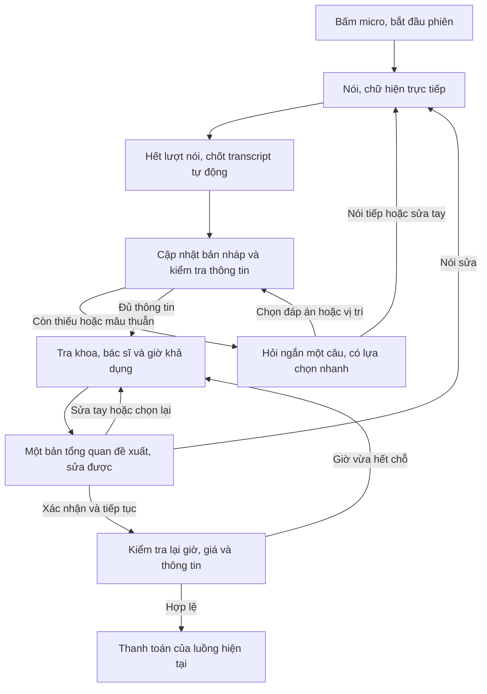

# Smart Scheduling — hội thoại streaming, bản thiết kế v2

**Cập nhật 2026-10-15:** [PRD triển khai](prd-smart-scheduling-implementation.md) là yêu cầu hiện hành. Model hỏi đáp đổi từ Sol sang `gpt-6-luna`, reasoning `low`, theo ngân sách test của chủ dự án. Phần chọn Sol bên dưới là lịch sử thiết kế; luồng streaming và STT giữ nguyên.

Ngày 2026-10-14. Điều chỉnh theo phản hồi chủ dự án: bỏ bước duyệt transcript riêng và bỏ thao tác gửi phân tích sau mỗi lượt. Lúc viết, đây là đặc tả để triển khai, chưa có dịch vụ hay màn Flutter tương ứng.

**Trạng thái (19/10/2026):** Đã có backend và màn Flutter theo đặc tả này ([app](flutter_app/SMART-SCHEDULING.md)), đã chạy với OpenAI bằng key thật cho phần nhập tay ([kết quả kiểm thử](docs/kiem-thu-ai-that.md)). Chưa đo nhận giọng nói tiếng Việt với người dùng thật.

## Luồng chính

Người dùng không phải đọc lại/xác nhận một bản chép riêng hoặc bấm Gửi sau mỗi lượt nói. Cần một lần xác nhận **bản đề xuất đặt khám** trước thanh toán. Hành động này chưa tạo lịch thành công hoặc thu tiền; thanh toán tiếp tục theo cơ chế hiện tại.

Có thể bắt đầu từ lối vào “Đặt lịch thông minh” trên Trang chủ hoặc từ “Chưa biết chọn khoa?” trong luồng cơ bản. Không thay footer. Nếu vào giữa luồng, giữ toàn bộ ngữ cảnh đã xác nhận và không hỏi lại.

## Nói, sửa bằng giọng và xác định hết lượt

- Sau thao tác bật micro, hiển thị rõ “Đang nghe”, chỉ báo âm thanh/thời lượng và nút Dừng. Thông báo ngắn ngay tại đây rằng giọng nói đang được truyền đến dịch vụ để chép trực tiếp; không đợi thu xong mới thông báo dữ liệu đã được gửi.
- Transcript hiện theo từng phần khi đang nói; chữ tạm phân biệt với lượt đã chốt. Không tự ép màn hình cuộn khi người dùng đang xem/sửa nội dung cũ; có lối trở về nội dung mới.
- Hết lượt nói được xác định bằng VAD ở ứng dụng. Đề xuất thử khoảng lặng 1.5–2 giây ban đầu, đo lại với người dùng nói chậm; đây chưa phải thông số chốt. Có nút “Xong lượt nói” tùy chọn khi VAD khó nhận biết, không bắt bấm.
- Sau commit audio, đợi transcript final của đúng `item_id` rồi tự gửi lượt sang bộ điều phối. Không chạy gợi ý trên mỗi ký tự tạm. Ghép sự kiện bằng ID/thứ tự vì completion các lượt có thể về khác thứ tự.
- Trong cửa sổ xử lý sau lượt nói, nếu micro còn bật và người dùng nói tiếp, nhận lượt mới, đánh dấu kết quả đang xử lý đã cũ. Không để kết quả cũ thay thế bản nháp mới hoặc tự chuyển thanh toán. Trạng thái micro luôn hiển thị, không âm thầm nghe.
- Khi đã hiện câu hỏi hoặc bản đề xuất, dừng micro; nút “Nói tiếp” mở lượt mới. Không giữ micro khi ở nền, rời màn hình, sang thanh toán, hết hạn phiên hoặc người dùng bấm Dừng. Giới hạn phiên/lượt cần được thực thi và thông báo trước khi hết hạn.
- Ví dụ “Tôi muốn khám sáng thứ Sáu… à không, chiều thứ Bảy” là yêu cầu sửa lựa chọn, không nối hai ngày thành một mô tả. AI tạo thay đổi có cấu trúc, giữ các trường không bị sửa; điểm mâu thuẫn chưa rõ thì hỏi lại.
- Sửa tay/dropdown là dữ liệu đã xác nhận. Model không được tự ghi đè một lựa chọn vừa sửa tay trừ khi người dùng có yêu cầu sửa rõ ràng ở lượt mới. Hiển thị trường vừa thay đổi, có Hoàn tác.

Nhận biết hết lượt không thể đảm bảo tuyệt đối. Thiết kế phải chịu được ngừng lấy hơi, âm nền, câu dở dang, nói đè khi đang xử lý và kết nối gián đoạn mà không tạo hành động đặt lịch ngoài ý muốn.

## Hỏi lại đúng thông tin còn thiếu

Bộ điều phối lấy dữ liệu từ hội thoại, hồ sơ và lựa chọn đã có. Không biến phần này thành danh sách câu hỏi bắt người dùng trả lời lại toàn bộ form. Mỗi lượt hỏi một điểm cần làm rõ; không giữ giới hạn cứng hai câu của prototype cũ nếu chưa đủ dữ liệu để đặt khám.

| Chưa rõ | Câu hỏi hoặc lựa chọn mẫu |
| --- | --- |
| Chưa biết người khám | “Bạn đặt cho ai?” — các hồ sơ có sẵn, thêm người khám, nói tiếp |
| Chưa biết khu vực/cơ sở và cần để tìm nơi khám | “Bạn muốn khám ở khu vực nào?” — Dùng vị trí hiện tại, Chọn khu vực/cơ sở, Nói tiếp |
| Chưa chọn hình thức | “Bạn muốn khám BHYT hay dịch vụ?” — hai lựa chọn hoặc nói tiếp |
| Thông tin triệu chứng chưa đủ/không rõ | Câu hỏi bổ sung ngắn dựa trên nội dung chuyên môn đã được duyệt; cho nhập/nói, không tự bổ sung triệu chứng |
| Chưa có ưu tiên thời gian | “Bạn muốn khám khi nào?” — Sớm nhất còn chỗ, Chọn ngày/buổi, Nói tiếp |
| Không có giờ đáp ứng | Cho đổi ngày/buổi, bác sĩ, cơ sở; không tự thay ràng buộc đã xác nhận |

Không hỏi vị trí nếu người dùng đã chọn cơ sở cụ thể. Hỏi khu vực muốn khám hữu ích hơn yêu cầu địa chỉ cư trú. Chỉ xin quyền vị trí khi bấm “Dùng vị trí hiện tại”; vị trí điện thoại là nơi đang đứng, không mặc định nơi muốn khám. Từ chối quyền hoặc GPS không có vẫn chọn/nói khu vực được. Chỉ cần vị trí foreground, không theo dõi nền. Tra cơ sở theo khoảng cách bằng logic backend; không cần gửi tọa độ chính xác vào LLM.

Nếu người dùng không biết bác sĩ, hệ thống có thể đề xuất bác sĩ còn lịch thuộc khoa/cơ sở phù hợp. Không cần hỏi tên bác sĩ ở mọi lượt. Nếu người dùng nói “gần nhất”, “sớm nhất”, “buổi sáng”, phải thể hiện tiêu chí đó trong đề xuất, không biến thành tuyên bố “bác sĩ tốt nhất” hoặc “ít chờ nhất”.

## Bản tổng quan cuối và sửa đề xuất

Một màn tổng quan hiển thị: người khám, BHYT/dịch vụ, khu vực/cơ sở/địa chỉ, tóm tắt yêu cầu, khoa và giải thích ngắn, bác sĩ, ngày giờ, phí dự kiến/phạm vi phí và người nhận thông báo. Chỉ hiển thị lựa chọn có dữ liệu tương ứng; không điền giả vào trường còn thiếu.

- Từng phần có Sửa: dropdown cho danh sách ngắn, màn/bottom sheet tìm kiếm khi danh sách dài, chọn ngày/giờ hoặc Nói lại yêu cầu.
- Đổi cơ sở/khoa/bác sĩ/ngày khiến giờ cũ không hợp lệ thì xóa/đề xuất lại phần phụ thuộc và báo rõ. Giữ dữ liệu còn hợp lệ, không bắt nói lại toàn bộ.
- Nội dung chỉnh sửa và slot ID phải được server kiểm tra. AI chỉ yêu cầu tra catalog/lịch qua công cụ được giới hạn; không tự bịa bác sĩ, phí hay slot và không có công cụ tự thanh toán.
- Nút chính “Xác nhận và tiếp tục thanh toán”. Chỉ bật khi bản nháp đủ và không có kết quả cập nhật chưa hoàn tất. Nếu người dùng đang nói sửa, tạm khóa nút này cho tới khi xử lý hoặc hủy lượt sửa.
- Khi bấm, chốt phiên bản proposal, kiểm tra lại người/hình thức/cơ sở/khoa/bác sĩ/slot/phí/liên hệ. Nếu còn hợp lệ, nạp vào BookingController qua một hành động áp dụng nguyên tử và đi thẳng bước Thanh toán, không bắt đi qua sáu màn chọn lại hoặc thêm một màn Kiểm tra giống hệt.
- Nếu slot vừa mất hoặc giá thay đổi, hiển thị thay đổi và yêu cầu duyệt đề xuất mới. Không tự chọn slot khác rồi thanh toán. Khóa gửi lặp và giữ cơ chế đối soát trạng thái hiện có.

## Model và kiến trúc cập nhật

`gpt-live-transcribe` cho chữ xuất hiện trong lúc nhận audio; `gpt-6.1-sol` vẫn xử lý hội thoại, câu hỏi và đề xuất cấu trúc. OpenAI hiện khuyến nghị model live cho audio đang đến. Model này **không hỗ trợ server_vad/semantic_vad**; dùng VAD ở app và commit lượt chủ động. Nguồn: [Realtime transcription](https://developers.openai.com/api/docs/guides/realtime-transcription), [VAD](https://developers.openai.com/api/docs/guides/realtime-vad).

Giá được công bố cho model live là $0.017/phút audio, khác model file đã chọn trước. Chưa có đo chi phí/độ trễ hoặc quyền truy cập tài khoản. Model live không có function calling/Structured Outputs; phần lập đề xuất thuộc Sol và bộ điều phối. Nguồn: [GPT-Live-Transcribe](https://developers.openai.com/api/docs/models/gpt-live-transcribe).

Đề xuất vòng đầu: Flutter gửi PCM 24 kHz mono qua WebSocket tới backend local; backend relay vào phiên transcription OpenAI. Transcript deltas/final đi ngược về UI. API key vẫn chỉ ở backend `.env`; USB `adb reverse` tiếp tục dùng cho kết nối local. Không cần nhúng key dài hạn vào app. Bản file-upload cũ chỉ là phương án dự phòng có thông báo nếu sau này triển khai, không coi upload sau ghi âm là realtime.

Hợp đồng đề xuất:

- WebSocket có sự kiện `audio.append`, `turn.commit`, `turn.cancel`, `transcript.delta`, `transcript.final`, `session.error`; tên này là giao thức nội bộ dự kiến, cần mapping rõ sang API OpenAI khi triển khai.
- Bộ điều phối hội thoại trả `ask`, `proposal`, `needs_urgent_help`, `fallback`; lưu `session_id`, `turn_id`, `draft_version`, `proposal_version`, các trường đã biết/nguồn của chúng, câu hỏi còn thiếu và phạm vi catalog. Transcript delta chỉ phục vụ hiển thị.
- Tool phía server chỉ đọc catalog, tra khoa/cơ sở/bác sĩ/slot và kiểm tra giá/khả dụng. Backend kiểm tra schema và quyền truy cập; không tin ID hay eligibility chỉ vì LLM/client gửi lên.
- Kết quả cũ được bỏ khi version không còn khớp. Đổi người khám xóa nội dung sức khỏe/gợi ý người trước. Không log audio, transcript, tọa độ hoặc API key. Giới hạn phiên, timeout, backpressure và xóa buffer khi kết thúc.

STT, VAD, quyền micro/vị trí và phiên WebSocket đều chưa được triển khai. Chưa cài thư viện VAD hoặc location; cần chọn/đo trên OPPO trước khi chốt. Câu hỏi hiển thị bằng chữ và lựa chọn nhanh; đọc câu hỏi thành tiếng có thể bổ sung riêng, không bắt buộc TTS để hoàn thành luồng này.

## Fallback và phạm vi an toàn

Vẫn có nhập tay, tự chọn theo luồng cơ bản và giữ dữ liệu hợp lệ khi STT/AI/mạng lỗi. Nhánh có dấu hiệu cần hỗ trợ khẩn theo quy tắc chuyên môn không được chuyển thành đặt khám thường. Chưa có dữ liệu vận hành thì chỉ đề xuất giờ còn chỗ, không dự đoán thời gian chờ. Catalog/lịch hiện vẫn giả lập; nối OpenAI không biến chúng thành lịch bệnh viện thật.

Kiểm tra trước triển khai thật: người lớn tuổi ngừng lấy hơi, sửa giữa câu/giữa lượt, phủ định, kết quả sai thứ tự, nói tiếp trong lúc model xử lý, sửa tay cùng lúc, từ chối quyền, vị trí không phải nơi muốn khám, hết slot lúc xác nhận, dữ liệu khẩn cấp và mất kết nối. Tiêu chí đầu tiên là không mất sửa đổi, không bỏ qua câu hỏi bắt buộc và không thanh toán/tạo lịch ngoài xác nhận người dùng.

Chưa có thử nghiệm với audio hoặc người dùng thật. Đã gọi API thật cho phần nhập tay (19/10/2026).
