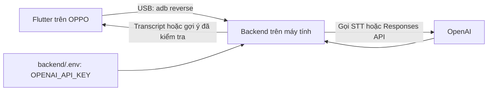

# Nghiên cứu Smart Scheduling và STT

Ngày tra cứu: 2026-10-14. AI tổng hợp từ tài liệu chính thức và PRD hiện có. Đây là đề xuất triển khai, chưa tích hợp OpenAI, chưa ghi âm hoặc gọi API. Chủ dự án đã báo hoàn thành thử luồng đặt lịch trên điện thoại; chưa có log chi tiết để suy ra tỷ lệ thành công.

**Cập nhật v2:** Luồng nhấn ghi/dừng, tải file và xác nhận transcript bên dưới đã được thay bằng [hội thoại streaming](smart-scheduling-conversation.md) theo phản hồi chủ dự án. Model STT hiện chọn `gpt-live-transcribe`; tự xử lý sau lượt nói, hỏi lại khi thiếu và duyệt một bản tổng quan trước thanh toán. Phần API key/USB và giới hạn dữ liệu vẫn áp dụng; phần upload-file và endpoint cũ chỉ giữ làm tham chiếu của nghiên cứu v1, không phải kế hoạch hiện hành.

## 1. Model được chọn cho pilot

| Tác vụ | Lựa chọn | Lý do và giới hạn |
| --- | --- | --- |
| Hiểu mô tả và gợi ý chuyên khoa | `gpt-6.1-sol`, Responses API, reasoning `medium`, Structured Outputs | Tài liệu định vị cân bằng chất lượng/chi phí, có đầu ra theo schema. Dùng làm baseline chất lượng cho pilot; không suy ra model đã được chứng nhận chọn khoa hoặc nhận diện cấp cứu. |
| Chuyển giọng nói thành văn bản | `gpt-transcribe`, Audio Transcriptions API | Tài liệu hiện tại khuyến nghị cho bản ghi hoàn chỉnh; có gợi ý ngôn ngữ và thuật ngữ. Bắt đầu bằng nhấn ghi/dừng rồi tải bản ghi lên, cho người dùng sửa transcript. |
| Tối ưu chi phí sau đánh giá | So sánh `gpt-6-luna`; STT so sánh `gpt-4o-mini-transcribe` | Chỉ chuyển khi bộ đánh giá tiếng Việt cho kết quả chấp nhận được. Không tự chuyển model khi lỗi quyền truy cập. |
| Xếp giờ còn chỗ / ít chờ | Quy tắc và dữ liệu lịch, không giao cho LLM tự đoán | Dùng dữ liệu khả dụng hiện có; cần dữ liệu vận hành và kiểm chứng riêng trước khi ước tính thời gian chờ. |

Đây là **lựa chọn kỹ thuật của dự án**, chưa phải kết quả benchmark. Model, giá và quyền tài khoản có thể thay đổi. Tài liệu hiện ghi GPT-6.1 Sol $2/triệu token đầu vào, $10/triệu token đầu ra; GPT-Transcribe $0.0045/phút. Token reasoning cũng ảnh hưởng hóa đơn; chưa ước tính chi phí mỗi lượt khi chưa đo payload/thời gian nói thực tế. Nguồn: [catalog](https://developers.openai.com/api/docs/models), [Sol](https://developers.openai.com/api/docs/models/gpt-6.1-sol), [Transcribe](https://developers.openai.com/api/docs/models/gpt-transcribe), [Mini Transcribe](https://developers.openai.com/api/docs/models/gpt-4o-mini-transcribe).

## 2. API key nằm ở đâu khi test trên Android?



OpenAI yêu cầu giữ API key ở server, không đưa vào client. Flutter `.env` dạng asset, `--dart-define`, mã nguồn hoặc obfuscation không tạo được kho bí mật cho key dùng chung. Web frontend cũng có giới hạn tương tự; `.env` chỉ bảo vệ key nếu phần đọc key chạy phía server và không gửi xuống trình duyệt. Nguồn: [OpenAI authentication](https://developers.openai.com/api/reference/overview#authentication), [giới hạn obfuscation của Flutter](https://docs.flutter.dev/deployment/obfuscate).

Đã chuẩn bị [backend/.env.example](backend/.env.example). Sau này sao chép thành `backend/.env`, điền key cục bộ và khởi động backend. Hiện mới có mẫu, chưa có server tự nạp key. Không cần đưa key lên điện thoại. Đổi key chỉ cần khởi động lại backend, không build lại APK.

Khi triển khai xong server và client config, cách test ưu tiên qua USB:

```powershell
. .\scripts\activate.ps1
adb -s 79a5519 reverse tcp:8080 tcp:8080
Set-Location .\05-prototype\flutter_app
flutter run -d 79a5519 --dart-define=API_BASE_URL=http://127.0.0.1:8080
```

Lệnh `flutter run` trên chỉ có ý nghĩa **sau khi code đã đọc `API_BASE_URL` và backend đang chạy**. Đây chưa phải cách kích hoạt AI trong APK hiện tại. `127.0.0.1` trên điện thoại đến máy tính nhờ port reverse; rút USB/khởi động lại có thể cần thiết lập lại. Không dùng địa chỉ emulator `10.0.2.2` cho OPPO thật. Phải có Internet ở máy chạy backend để gọi OpenAI. Nguồn: [ADB reverse](https://developer.android.com/develop/ui/views/layout/webapps/access-local-server).

Backend dev chỉ bind `127.0.0.1`; không cần mở port LAN hoặc public tunnel. Android HTTP localhost cần cấu hình cleartext giới hạn cho localhost **chỉ ở bản debug**, không bật toàn cục cho release. Khi triển khai server từ xa, dùng HTTPS và xác thực/rate limit phía server; app chỉ biết URL và phiên đăng nhập của chính app. Nguồn: [Android network security](https://developer.android.com/privacy-and-security/security-config).

## 3. Luồng Smart Scheduling đề xuất

Giữ footer và luồng cơ bản đã hoàn thành. Điểm vào ở bước Chuyên khoa: “Chưa biết chọn khoa? Nhập hoặc nói triệu chứng”.

1. Giữ người khám, hình thức, cơ sở; cho nhập tay hoặc chủ động ghi âm. Giải thích âm thanh được gửi qua backend đến OpenAI khi người dùng chọn chuyển thành văn bản.
2. Ghi/dừng/hủy rõ ràng, hiển thị thời gian. Đề xuất giới hạn 60 giây và 5 MiB/lượt để thử; đây là giới hạn ứng dụng, nhỏ hơn giới hạn 25 MB của API. Không ghi nền; dừng khi app vào nền hoặc người dùng rời màn hình.
3. Ghi dạng AAC trong M4A trên Android nếu thiết bị hỗ trợ; backend xác minh MIME/nội dung, kích thước và thời lượng. Dùng file tạm trong vùng riêng của app, xóa sau xử lý/hủy; không ghi vào thư viện âm thanh chung.
4. Backend gọi `/v1/audio/transcriptions`. Với `gpt-transcribe`, dùng `languages` để gợi ý tiếng Việt, không nhầm với trường `language` của model STT cũ. Dùng ít thuật ngữ liên quan làm hint, không nhét danh sách triệu chứng khiến transcript tự thêm nội dung. Cần kiểm tra hỗ trợ `vi` và chất lượng với tài khoản thực trước khi chốt.
5. Hiển thị transcript cho người dùng sửa, nhất là phủ định, thời gian xuất hiện và số đo. Chỉ gửi sang bước gợi ý khi người dùng xác nhận. Không tự gộp “ghi âm xong” với “gửi phân tích”.
6. Backend gửi văn bản và ngữ cảnh tối thiểu sang Sol: độ tuổi nếu cần, hình thức/cơ sở, catalog đã được server xác minh. Không cần họ tên, số điện thoại hoặc ngày sinh đầy đủ.
7. Cho hỏi bổ sung từng câu (tối đa hai câu là giới hạn UX của pilot), gợi ý một khoa hoặc từ chối gợi ý khi thiếu dữ liệu. Luôn có tự chọn khoa/trợ giúp.
8. Người dùng bấm “Chọn khoa này”; áp dụng qua controller hiện có để xóa bác sĩ/giờ cũ đúng quy tắc, rồi đi tiếp luồng cơ bản. Không tự tạo lịch hoặc thanh toán.

Nguồn STT: [file transcription](https://developers.openai.com/api/docs/guides/speech-to-text). Realtime có thể nghiên cứu ở vòng sau nếu cần chữ xuất hiện khi đang nói; vòng này không cần cuộc hội thoại giọng nói hai chiều hoặc TTS.

## 4. Hợp đồng và xử lý kết quả

Đề xuất ba endpoint backend, chưa tồn tại trong source:

| Endpoint | Mục đích |
| --- | --- |
| `GET /health` | Trạng thái server/cấu hình, tuyệt đối không trả key |
| `POST /v1/transcriptions` | Multipart audio, trả transcript để sửa; không tự gợi ý khoa |
| `POST /v1/specialty-suggestions` | Văn bản đã xác nhận + ngữ cảnh; trả kết quả cấu trúc |

Các trạng thái kết quả gợi ý: `suggestion`, `needs_information`, `needs_urgent_help`, `out_of_catalog`, `fallback`. Các trường dự kiến: `department_id` nullable, `alternative_department_id` nullable, `explanation`, `question` nullable, `context_version`, `request_id`. Không trả chẩn đoán, thuốc hoặc tỷ lệ tin cậy giả.

Responses dùng JSON Schema strict; backend vẫn phải kiểm tra ID thuộc catalog, phạm vi tiếp nhận và hình thức. Khoa không có ở cơ sở cần cho đổi cơ sở có xác nhận hoặc nhờ hỗ trợ, không ép chọn một khoa sai trong danh sách. JSON đúng schema không chứng minh gợi ý đúng về lâm sàng. Xử lý riêng refusal, response chưa hoàn chỉnh, timeout, 401/403/429 và lỗi mạng. Nguồn: [Structured Outputs](https://developers.openai.com/api/docs/guides/structured-outputs).

Mỗi yêu cầu gắn phiên bản ngữ cảnh; đổi người khám/cơ sở/hình thức hoặc sửa triệu chứng phải hủy/loại kết quả cũ. Không dùng phản hồi đến muộn để ghi đè lựa chọn mới. Đổi người khám xóa transcript, audio tạm và gợi ý người trước. Hủy ở app không đảm bảo yêu cầu đã gửi sẽ dừng tính phí phía nhà cung cấp; giới hạn đầu vào và thời lượng để kiểm soát chi phí.

## 5. Giờ ít chờ, an toàn và dữ liệu

Repository hiện chỉ mô phỏng khả dụng. MVP có thể gợi ý **“Giờ còn chỗ sớm nhất”** theo ràng buộc người dùng; chưa có cơ sở nói “vắng nhất” hoặc “ít chờ”. Muốn ước tính chờ cần lịch bác sĩ, lịch đặt/giữ chỗ, check-in, tải thực tế, thời lượng khám và mốc cập nhật. Thuật toán xếp giờ nên có thể kiểm tra lại, không để model bịa phút chờ. Dữ liệu cũ/thiếu phải về danh sách giờ thông thường. Đây là quyết định kiến trúc dựa trên giới hạn dữ liệu trong PRD.

Nhánh hỗ trợ khẩn cấp cần nội dung và quy tắc do chuyên môn duyệt. Không để LLM là lớp nhận diện duy nhất, không xem “model không cảnh báo” là xác nhận an toàn. Trường hợp nghi ngờ cần hỗ trợ khẩn không được xử lý như lỗi mạng rồi tự đưa sang đặt khám thường. Trước khi có quy tắc chuyên môn, chỉ đánh giá bằng tình huống giả định có nhãn; chưa dùng cho quyết định chăm sóc thật.

Không log audio/transcript/triệu chứng hoặc API key; log ID, model, độ trễ, mã lỗi và usage khi cần. Xóa tệp tạm ở app/backend cả khi lỗi/hủy. Dự kiến `store: false` cho Responses; không coi đó là cam kết không lưu dữ liệu ở mọi lớp. Tài liệu OpenAI nêu dữ liệu API không dùng huấn luyện theo mặc định trừ khi opt-in, có các chính sách lưu giữ theo endpoint và loại tài khoản; phải kiểm tra lại cấu hình trước khi đưa dữ liệu sức khỏe thật lên hệ thống. Nguồn: [Data controls](https://developers.openai.com/api/docs/guides/your-data).

## 6. Thứ tự triển khai và đánh giá

1. Backend local, nạp `.env`, health, mock/real adapter, timeout/giới hạn đầu vào; app đọc URL, kết nối USB. Chưa cần deploy cloud.
2. Gợi ý từ nhập văn bản, schema, hỏi bổ sung, xác nhận khoa và fallback; giữ luồng cơ bản.
3. STT nhấn ghi/dừng, xin quyền đúng lúc, transcript sửa được, hủy/xóa file và hỗ trợ khi không cấp quyền micro.
4. Kiểm tra trên OPPO với giọng Bắc/Trung/Nam, giọng người lớn tuổi, nói chậm, tiếng ồn và câu phủ định; so sánh transcript với bản chép chuẩn có đồng ý sử dụng. Ghi WER và lỗi làm đổi nghĩa riêng, không chỉ đánh giá văn bản “trôi chảy”.
5. Bộ gợi ý cần nhãn do người có chuyên môn duyệt, gồm câu mơ hồ, nhiều triệu chứng, ngoài catalog, trẻ em, cần hỗ trợ khẩn và prompt injection. Đo lỗi gợi ý/không chịu từ chối, không bỏ sót tình huống nguy cơ trong bộ thử, độ trễ và chi phí; chưa đặt tỷ lệ chính xác hoặc ngưỡng đạt khi chưa có dữ liệu/chuyên môn.
6. Chỉ phát triển ước tính chờ khi có dữ liệu phù hợp; ở giai đoạn này xếp giờ còn chỗ với tên đúng.

Package Flutter đề xuất: [`record`](https://pub.dev/packages/record) để ghi âm/xin quyền micro và [`http`](https://pub.dev/packages/http) để gửi JSON/multipart. Chưa cài thêm package. Backend đề xuất Node.js/TypeScript và OpenAI SDK chính thức; runtime/dependency cài riêng trong dự án, giữ yêu cầu dễ gỡ ban đầu.

Không sửa Flutter hoặc cài lại APK trong vòng nghiên cứu này. Mẫu cấu hình không chứa key; không gọi API hay phát sinh chi phí OpenAI; chưa commit/push.
